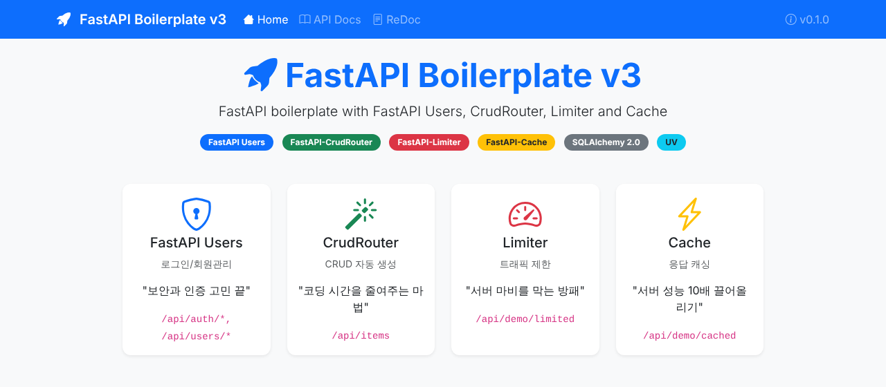
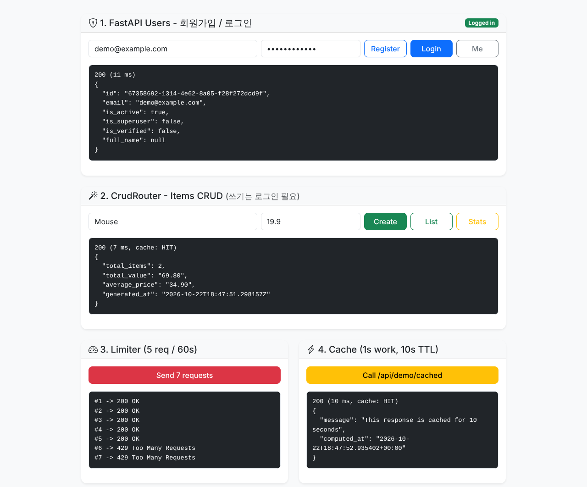
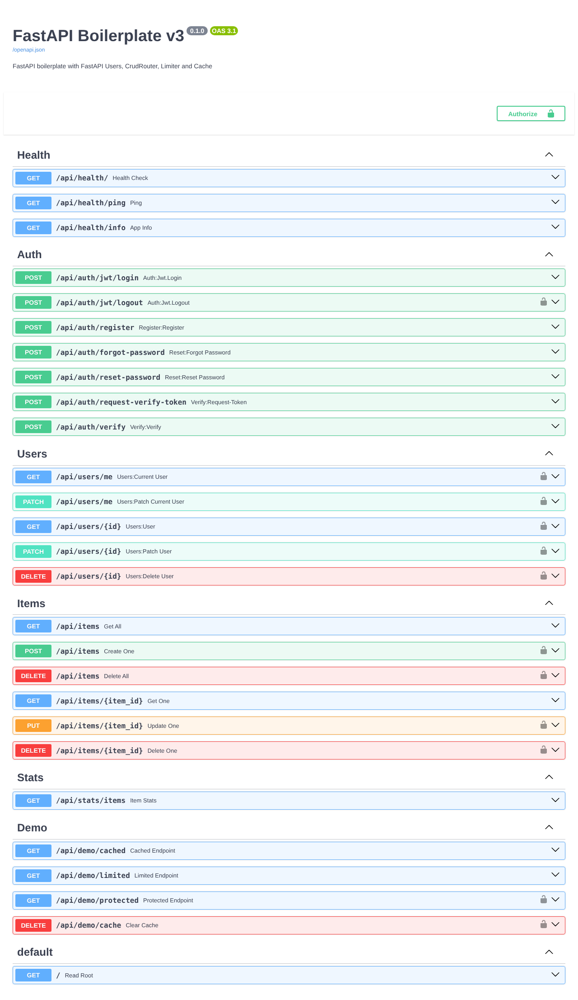

# FastAPI boilerplate V3

A production-ready FastAPI boilerplate that bundles the four extensions most APIs end up needing — authentication, auto-generated CRUD, rate limiting and response caching — on top of the [V2 template](https://github.com/jeonck/fastapi-boilerplate-v2) layout (UV, Jinja2, one-command run).

| Library | Role | One-liner |
|---|---|---|
| **FastAPI Users** | 로그인/회원관리 | "보안과 인증 고민 끝" |
| **FastAPI-CrudRouter** | CRUD 자동 생성 | "코딩 시간을 줄여주는 마법" |
| **FastAPI-Limiter** | 트래픽 제한 | "서버 마비를 막는 방패" |
| **FastAPI-Cache** | 응답 캐싱 | "서버 성능 10배 끌어올리기" |



## 📸 Screenshots

### Playground (`/`)

Register → login → create items → cached stats → rate limit → cached endpoint, all from the browser.



<details>
<summary><b>Swagger UI (<code>/docs</code>)</b></summary>



</details>

## 🚀 Features

- **FastAPI Users** — register, JWT login/logout, password reset, email verification, `/users/me`, superuser-only user management
- **FastAPI-CrudRouter** — full CRUD for `Item` generated from one router declaration, with per-route auth
- **FastAPI-Limiter** — per-client rate limits (`rate_limit(times, seconds)` dependency), stricter limits on auth endpoints
- **FastAPI-Cache** — `@cache` decorator with namespace-based invalidation after writes
- **Redis optional** — in-memory backends by default; set `REDIS_URL` to share limits/cache across workers
- **SQLAlchemy 2.0** — async engine (FastAPI Users) + sync engine (CrudRouter), SQLite by default
- **Data integrity by design** — money as `NUMERIC`/`Decimal`, business rules as DB constraints, constraint violations → `409 Conflict` ([design guide](docs/design-guide.md))
- **GZip** response compression
- **UV**, **Jinja2 + Bootstrap 5** playground page, **pytest** suite, `./run.sh` — same as V2

## 📁 Project Structure

```
fastapi-boilerplate-v3/
├── app/
│   ├── api/                      # API route handlers
│   │   ├── auth.py               # FastAPI Users routers (auth, register, users)
│   │   ├── items.py              # CrudRouter-generated Item CRUD
│   │   ├── stats.py              # Cached aggregation endpoint
│   │   ├── demo.py               # Cache / limiter / auth demo endpoints
│   │   └── health.py             # Health check endpoints
│   ├── core/                     # Core configuration & integrations
│   │   ├── config.py             # Settings (env vars)
│   │   ├── database.py           # SQLAlchemy async + sync engines
│   │   ├── users.py              # FastAPI Users setup (UserManager, JWT backend)
│   │   ├── limiter.py            # FastAPI-Limiter setup (rate_limit dependency)
│   │   ├── cache.py              # FastAPI-Cache setup (backend, key builder)
│   │   ├── crud.py               # CRUDRouter (IntegrityError -> 409)
│   │   ├── crudrouter_compat.py  # CrudRouter Pydantic v2 patch
│   │   └── errors.py             # IntegrityError -> 409 Conflict handler
│   ├── models/                   # SQLAlchemy ORM models
│   │   ├── user.py
│   │   └── item.py
│   ├── schemas/                  # Pydantic models
│   │   ├── base.py
│   │   ├── user.py
│   │   └── item.py
│   ├── scripts/
│   │   └── create_superuser.py   # Admin account creation
│   ├── static/                   # CSS, JS
│   ├── templates/                # Jinja2 templates (playground page)
│   └── main.py                   # Application entry point
├── docs/
│   ├── design-guide.md           # Data design guide (NULL, bitemporal, money, time, soft delete, constraints)
│   └── images/                   # README screenshots
├── tests/                        # pytest suite (auth, items, limiter, cache, ...)
├── .env.example
├── pyproject.toml
├── run.sh                        # One-command setup & run
└── test_quick.sh                 # Live-server smoke test
```

## 🛠 Quick Start

### Prerequisites

- Python 3.10+
- [UV](https://docs.astral.sh/uv/)

```bash
curl -LsSf https://astral.sh/uv/install.sh | sh
```

### Installation & Running

```bash
cp .env.example .env      # then change SECRET_KEY
chmod +x run.sh
./run.sh
```

- Playground: http://localhost:8000/
- Swagger UI: http://localhost:8000/docs
- ReDoc: http://localhost:8000/redoc

Tables are created automatically on startup (SQLite file `app.db`).

## 🎯 Available Commands

```bash
./run.sh                                       # Install deps & run with auto-reload
./run.sh install                               # Install dependencies only
./run.sh test                                  # Run pytest
./run.sh createsuperuser admin@example.com pw  # Create an admin user
./run.sh clean                                 # Remove .venv and caches
./test_quick.sh                                # Start the server and smoke-test every feature
```

## 🌐 API Endpoints

### Health Checks
- `GET /api/health/` · `GET /api/health/ping` · `GET /api/health/info`

### Auth & Users (FastAPI Users)
| Method | Path | Description |
|---|---|---|
| POST | `/api/auth/register` | Register |
| POST | `/api/auth/jwt/login` | Login (form: `username`, `password`) → JWT |
| POST | `/api/auth/jwt/logout` | Logout |
| POST | `/api/auth/forgot-password` · `/api/auth/reset-password` | Password reset |
| POST | `/api/auth/request-verify-token` · `/api/auth/verify` | Email verification |
| GET/PATCH | `/api/users/me` | Current user |
| GET/PATCH/DELETE | `/api/users/{id}` | Manage users (superuser) |

Auth endpoints are limited to `AUTH_RATE_LIMIT_TIMES` requests per `AUTH_RATE_LIMIT_SECONDS` (default 10/60s) per client.

### Items (FastAPI-CrudRouter)
| Method | Path | Access |
|---|---|---|
| GET | `/api/items?skip=&limit=` | Public |
| GET | `/api/items/{item_id}` | Public |
| POST | `/api/items` | Logged in |
| PUT | `/api/items/{item_id}` | Logged in |
| DELETE | `/api/items/{item_id}` | Logged in |
| DELETE | `/api/items` | Superuser |

### Stats & Demo
| Method | Path | Shows |
|---|---|---|
| GET | `/api/stats/items` | Cached aggregation, invalidated on item writes |
| GET | `/api/demo/cached` | 1s computation cached for 10s (`X-FastAPI-Cache: HIT/MISS`) |
| GET | `/api/demo/limited` | 5 requests / 60s, then `429` |
| GET | `/api/demo/protected` | Requires `Authorization: Bearer <token>` |
| DELETE | `/api/demo/cache` | Clear whole cache (superuser) |

### Try it with curl

```bash
curl -X POST localhost:8000/api/auth/register -H 'Content-Type: application/json' \
     -d '{"email":"me@example.com","password":"secret123"}'
TOKEN=$(curl -s -X POST localhost:8000/api/auth/jwt/login \
     -d 'username=me@example.com&password=secret123' | python -c 'import sys,json;print(json.load(sys.stdin)["access_token"])')
curl -X POST localhost:8000/api/items -H "Authorization: Bearer $TOKEN" \
     -H 'Content-Type: application/json' -d '{"name":"Keyboard","price":"49.90"}'
curl -i localhost:8000/api/stats/items     # X-FastAPI-Cache: MISS, then HIT
```

## 📚 Development Guide

### Add a CRUD resource (CrudRouter)

1. Model in `app/models/` (and import it in `app/models/__init__.py`)
2. `Create` / response schemas in `app/schemas/`
3. Router in `app/api/`:

```python
from app.core.crud import CRUDRouter   # SQLAlchemyCRUDRouter + Pydantic v2 patch + 409

router = CRUDRouter(
    schema=Product, create_schema=ProductCreate, update_schema=ProductCreate,
    db_model=ProductModel, db=get_db, prefix="products",
    dependencies=[Depends(rate_limit())],
    create_route=[Depends(current_active_user)],
)
```

4. `app.include_router(router, prefix="/api")` in `app/main.py`

Put business rules in the model as constraints (`unique=True`, `CheckConstraint`, ...), not as
`if exists: raise` checks in Python — those race under concurrent requests. Violations are
answered with `409 Conflict` by the handler in `app/core/errors.py`.

To customize a generated route, override it with the same path, e.g. `@router.get("")`, or disable it with `get_all_route=False`.

### Protect an endpoint (FastAPI Users)

```python
from app.core.users import current_active_user, current_superuser

@router.get("/me/orders")
async def my_orders(user: User = Depends(current_active_user)): ...
```

Send verification / reset emails from the hooks in `UserManager` (`app/core/users.py`).

### Rate limit an endpoint (FastAPI-Limiter)

```python
from app.core.limiter import rate_limit

@router.post("/upload", dependencies=[Depends(rate_limit(times=3, seconds=60))])
```

Apply to a whole router with `APIRouter(dependencies=[Depends(rate_limit())])`.

### Cache an endpoint (FastAPI-Cache)

```python
from fastapi_cache import FastAPICache
from fastapi_cache.decorator import cache

@router.get("/products/top")
@cache(expire=300, namespace="products")
async def top_products(session: AsyncSession = Depends(get_async_session)): ...

await FastAPICache.clear(namespace="products")   # invalidate after writes
```

Cache keys are built from method + path + query string, so **don't cache per-user responses** without a custom `key_builder`.

## ⚙️ Configuration

All settings live in `.env` (see `.env.example`):

| Variable | Default | Description |
|---|---|---|
| `DATABASE_URL` | `sqlite+aiosqlite:///./app.db` | Async SQLAlchemy URL (sync URL is derived) |
| `SECRET_KEY` | dev placeholder | JWT / token signing key — **change it** |
| `ACCESS_TOKEN_EXPIRE_MINUTES` | `30` | JWT lifetime |
| `REDIS_URL` | unset | Enables Redis for limiter + cache |
| `RATE_LIMIT_ENABLED` | `True` | Global limiter switch |
| `RATE_LIMIT_TIMES` / `RATE_LIMIT_SECONDS` | `60` / `60` | Default limit |
| `AUTH_RATE_LIMIT_TIMES` / `AUTH_RATE_LIMIT_SECONDS` | `10` / `60` | Auth endpoint limit |
| `CACHE_ENABLED` | `True` | Global cache switch |
| `CACHE_EXPIRE_SECONDS` | `60` | Default TTL |

For PostgreSQL: `DATABASE_URL=postgresql+asyncpg://...` and `uv add asyncpg "psycopg[binary]"`.

## 🧪 Testing

```bash
./run.sh test        # or: uv run pytest -v
./test_quick.sh      # live server smoke test
```

Tests use a temporary SQLite database and cover health, pages, auth, CRUD, data integrity (Decimal money, constraints → 409), rate limiting and caching.

## 🚀 Deployment

```bash
uv run uvicorn app.main:app --host 0.0.0.0 --port 8000 --workers 4
```

Production checklist:
- Set a strong `SECRET_KEY`, `DEBUG=False`, `ENVIRONMENT=production`
- Set `REDIS_URL` — in-memory limits and cache are **per process**
- Use PostgreSQL and Alembic migrations instead of `create_all`
- Behind a proxy, make sure `X-Forwarded-For` is set by a trusted proxy (the limiter keys on it)

## 🧭 Data Design Guide

[`docs/design-guide.md`](docs/design-guide.md) (Korean) covers six data-design pitfalls that cause production incidents, with SQLAlchemy/Pydantic snippets:

1. Separate the meanings of `NULL` (status enums + CHECK)
2. Bitemporal history (insert, don't overwrite)
3. Money as `Decimal`, FX snapshot at event time — **applied** (`Item.price`)
4. Future events as wall-clock time + IANA time zone
5. Soft delete with partial unique indexes
6. Business rules as DB constraints, violations → `409` — **applied** (`uq_items_name`, `app/core/errors.py`)

> Upgrading from an earlier version of this boilerplate? `Item.price` changed from `FLOAT` to `NUMERIC(12,2)` and new constraints were added. `create_all` does not alter existing tables, so delete `app.db` (dev) or write an Alembic migration.

## ⚠️ Notes on library versions

- **fastapi-crudrouter 0.8.6** targets Pydantic v1; `app/core/crudrouter_compat.py` patches the two helpers that break on Pydantic v2. It also turns every `IntegrityError` into a `422` (on update, with the raw DB error message); `app/core/crud.py` lets them reach the global `409` handler instead.
- **fastapi-limiter 0.2.0** (pyrate-limiter based) scans `app.routes` and shares one bucket between all clients. `app/core/limiter.py` subclasses `RateLimiter` and uses a per-client bucket factory to fix both.

## 📄 License

MIT License — see [LICENSE](LICENSE).
